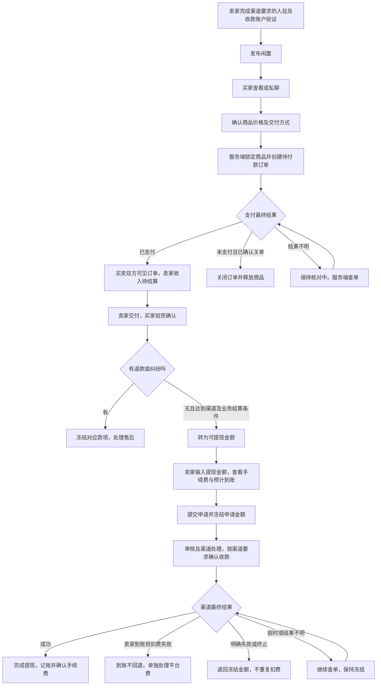

# 校园市场平台交易、结算与提现审查

审查日期：2026-09-04。依据：用户提供的两张客户聊天截图、当前工作区源码与本地回归测试。

**目标：** 明确客户新要求，检查现有市场能否承接，并形成可实施、可验收的交易与资金流程。

**架构建议：** 保留现有代售点订单，新增独立市场订单和卖家账本，通过经过商户能力核实的支付服务接入收款、结算及提现。订单、资金账、外部支付单分开记录，用事务、幂等业务号和对账衔接。

**技术基础：** 原生微信小程序、云开发数据库、Node.js 云函数、现有微信支付 HTTP 云函数及 Node 内置测试工具。

**本次交付范围：** 需求审查、源码差距、流程设计和实施验收计划，以及审查中复现的既有支付/退款状态问题修复。本次没有实现市场钱包，没有改变支付配置，没有调用真实付款、退款、转账，也没有部署。以下“建议”和“待确认”不代表客户已认可的产品规则。

## 1. 截图表达了什么

| 内容 | 判断 |
| --- | --- |
| 买家希望在本平台付款 | 客户明确提出的方向 |
| 卖家卖出后的钱先显示在平台，主动申请提现 | 第二张截图表达的目标体验 |
| 提现时平台收手续费 | 第二张截图表达的计费方向，具体计费规则缺失 |
| 参考闲鱼或另一款软件 | 体验参考，不能据此认定其资金架构、资质和接口可以直接照搬 |
| 提现到微信或支付宝 | 截图提到了两者，但没有确认必须同时支持；不能据此承诺支付宝提现 |

截图中的聊天内容作为需求材料分析，不作为部署、开通支付、联系他人、收款或转账的操作授权。截图中嵌入的小图无法可靠识别其资金产品，不据此判断后台实现。

尚未明确：卖家可提现的时间点、交付方式、手续费比例与最低收费、提现门槛与额度、收款账户、到账时间、自动还是人工审核、买家未确认怎么办、退款及纠纷规则。

## 2. 审查结论

这是市场交易模式的扩展：从“发布信息、私聊、自行交易”增加到“平台订单、支付、履约、结算、提现和售后”。当前市场无法完成该流程。

已有微信支付只说明项目具备代售点收款的代码基础，不能证明当前商户可以为个人卖家结算或提现。客户端显示的“余额”也不等于存在可支配的渠道资金。必须在实际支付产品支持的资金归属、结算周期与提现账户范围内设计。

建议首先核实微信“个人收款（二手交易场景）”的接入资格：其卖家主动收款并扣平台费的模式最贴近截图，但官方当前标注为灰度、尚未公开开放。若无法获准，才评估其他实际受理个人闲置交易的支付服务；通用平台收付通的卖家分类、商家转账场景不能直接套用。具体来源与差异见第 10 节。

## 3. 当前代码与缺口

下列行号对应本次审查时的工作区文件；未来修改可能移动。

| 发现 | 源码证据 | 对新需求的影响 |
| --- | --- | --- |
| 市场明确说明不提供平台付款 | `miniprogram/pages/home/index.wxml:22`、`miniprogram/pages/goods-detail/index.wxml:38`、`miniprogram/pages/publish-goods/index.wxml:4` | 页面文案、按钮、发布须知和真实服务能力必须同步切换 |
| 详情只有私聊与收藏，没有购买订单 | `miniprogram/pages/goods-detail/index.js:72`、`miniprogram/pages/goods-detail/index.wxml:52` | 新增“购买”、下单确认、买卖双方订单与售后入口 |
| 市场商品只有在售、已售、下架 | `cloudfunctions/goods/index.js:268` | 缺少下单占用；一件闲置可能被多个买家争抢，必须服务端原子锁定 |
| 卖家可自行标记已售，商品可物理删除 | `miniprogram/pages/profile/index.wxml:141`、`cloudfunctions/goods/index.js:286` | 不能让旧客户端的改状态/删除绕过资金流程；有订单后保留商品和证据快照 |
| 当前订单依赖代售点、库存和宿舍配送 | `cloudfunctions/orders/index.js:115`、`:152`、`:163` | 不能把市场商品 ID 直接交给现有购物车/订单函数；缺少卖家归属 |
| 完成订单由管理员推进 | `cloudfunctions/orders/index.js:277` | 不具备买家验货确认、卖家交付、争议暂停结算的市场流程 |
| 支付钩子只查 `orders`，更新代售点销量 | `cloudfunctions/pengyu-pay-fj7pei2f-demo-scfweb/services/orderService.js:22`、`:139` | 市场支付必须按可信业务订单路由，不能更新 `store_products` 或误结算给代售点 |
| 查单仅返回渠道查询结果 | `cloudfunctions/pengyu-pay-fj7pei2f-demo-scfweb/services/payService.js:145` | 回调丢失时还需服务端查单补偿，不能由客户端给卖家加余额 |
| 商家转账显式关闭 | `cloudfunctions/pengyu-pay-fj7pei2f-demo-scfweb/services/payService.js:199`、`services/orderService.js:232` | 存在转账路由或 SDK 模板不代表提现已启用 |
| 有管理员整单退款底层钩子，但没有市场账本衔接 | `cloudfunctions/pengyu-pay-fj7pei2f-demo-scfweb/services/orderService.js:108`、`:198`、`:211` | 要增加退款申请、金额冻结、结果补偿、退款与结算/提现互斥 |
| 没有市场钱包、流水和提现集合 | `deployment/recommended-indexes.json`，市场及个人页代码 | 需要新的服务端账本、提现记录、唯一索引、权限与对账任务 |
| 存在“求购”分类，其价格是预算 | `cloudfunctions/goods/index.js:18`、`miniprogram/pages/goods-detail/index.wxml:12` | 求购不能直接按出售商品付款；建议首版保留沟通，形成明确出售商品后再下单 |
| 同一双方共用会话，最新上下文会覆盖 | `cloudfunctions/chat/index.js:87`、`:173` | 私聊可复用，但支付必须绑定明确订单，不能用最后聊天商品推断交易 |
| 协议仍说明市场不提供担保支付 | `miniprogram/pages/legal/index.js:12`，部署手册第 10 节 | 产品切换时同步更新用户协议、隐私说明、提审材料和运营处理职责 |

另一个现状差异：`miniprogram/app.js:9–11` 当前已填写支付函数名且 `paymentBusinessHookReady` 为 `true`，README 仍称默认关闭。这只证明本地配置，不证明线上支付已恢复或提现可用；本次未改动该开关。

独立状态回放还复现了三个既有问题，均属于市场账本复用前要先修复的基础问题：退款成功回调先到时，迟到的退款请求响应可把状态改回 `refunding`；错误退款单号或不足整单金额的回调可把整单标成已退款；已退款的迟到支付异常单收到重复支付回调会退回 `payment_exception`。修复与新增回归测试结果见第 11 节。

## 4. 建议的用户完整流程

首版建议“一件闲置对应一笔订单，校内当面交付”。这是便于闭环的范围建议；如客户要求快递、议价、多件商品或部分退款，需补充对应规则后扩展。



### 买家

1. 可先浏览和私聊；购买时登录，服务端检查不能购买自己的商品、商品仍在售、卖家具备交易资格。
2. 确认页展示商品快照、真实价格、交付方式和售后规则；按已确认的需求计价，不接受客户端自报金额。
3. 待付款订单可继续支付或申请取消。页面取消收银台不等于支付渠道已关闭订单。
4. 支付结果由验签回调或可信服务端查单落库。页面支付成功但后台尚未确认时展示“支付结果确认中”，不诱导重复付款。
5. 已付款后可联系卖家、查看交付进度、确认收货或申请售后。卖家不能代买家确认收货。
6. 退款结果以渠道最终结果为准，并在订单中提供处理进度和运营联系入口。

### 卖家

1. 对外仍可展示站内副名称，收款资格验证按渠道要求完成；站内匿名身份不能替代支付实名验证。
2. 发布后可查看“我卖出的”。买家已付款时显示“待交付”和“待结算收入”，不显示为立即可提现。
3. 提交交付凭证或按确认后的校内交付流程操作，保留买卖双方可核验记录。微信要求的发货信息录入单独跟踪；页面标记已交付不等于微信侧已录入。
4. 买家确认、售后规则及渠道资金可用条件同时满足后，后台只记录一次可申请收款资格；渠道实际结算与到账在卖家确认收款后另行核销。
5. 在“我的收入”查看待结算、可提现、提现处理中、售后冻结、已到账和完整流水。
6. 主动提现前看到扣款金额、平台手续费、预计到账、到账账户及处理时效；可跟踪审核、待确认、处理中、成功、失败等状态。

### 运营

提供市场订单、支付异常、售后纠纷、退款、提现处理及对账入口。商品下架不应抹去已有交易；禁止管理员直接改余额或手动勾选“转账成功”冒充渠道成功。

财务操作使用专门的服务端权限和审计记录。现有 `outlet_admin` 不能因此获得市场退款/提现权限；任何管理员也不能修改其他人的提现收款人。

## 5. 订单与金额必须分别管理

### 状态建议

| 对象 | 建议状态 | 关键约束 |
| --- | --- | --- |
| 商品 | 在售 → 交易占用 → 已售；另有下架 | 只能有一笔有效占用；只有确认未支付且关单后才释放；退款成功不自动认定实物已退回 |
| 交易订单 | 待付款 → 待交付 → 待买家确认 → 已完成；关闭/异常分支 | 已完成不等于一定已经可提现，需同时检查结算及售后条件 |
| 支付 | 未支付 → 处理中 → 成功 / 已关闭 / 核对中 | 渠道成功终态不能被旧消息覆盖；迟到支付进入退款或异常处理 |
| 结算 | 待结算 → 可申请收款 → 渠道结算处理中 → 已结算；冻结/异常分支 | 可申请不等于已结算；同一订单收入只记一次，遇到售后停止释放 |
| 退款 | 申请 → 审核 → 处理中 → 成功 / 失败 / 核对中 | 与结算及提现事务互斥；未知结果不能解冻后再付一遍 |
| 提现/领取售款 | 申请 → 审核 → 渠道处理中（含待用户确认）→ 卖家到账 → 扣费成功/扣费失败；另有未到账失败/已撤销 | 受理成功不等于到账成功；超时查原单；卖家到账与平台费分别核对 |

商品原有 `sold` 只是卖家手工标记，不能成为历史交易金额入账的依据。

### 余额及手续费口径

建议提现输入金额采用“从可提现余额扣减的总额”口径。提交前明确展示：

```text
本次扣减余额 = 申请提现金额
预计到账金额 = 申请提现金额 - 本次平台手续费
```

渠道收费如另行承担，必须单独写明承担方，避免与平台提现手续费混淆。费率、固定费、最低/最高收费、金额舍入、最低提现额与限额均以服务端配置计算，并把规则版本和报价写入提现单；改变费率不追溯重算已提交申请。若采用个人收款产品，需按可结算订单组成收款批次；能否支持任意输入金额或拆分订单，要按接口和渠道确认，不能把界面金额当作无来源钱包余额。

仅用于理解的示例：若客户后续确认提现费为 1%，申请扣减 100 元，则到账 99 元、平台费 1 元。**1% 是示例，不是本项目已确认费率。** 如果渠道不支持这种扣费时点和资金划拨方式，必须重新确认计费方案，不能仅修改页面数字。

金额全部使用整数分。拒绝零、负数、非整数分、超过余额/额度、扣费后到账不足渠道最低额等申请。未发生的收入、历史手工“已售”和客户端请求均不能增加余额。

申请提现时在同一数据库事务中扣减可提现并增加冻结款、创建唯一提现单；卖家到账与平台费用分别按可信结果记账。只有确认卖家未到账且渠道已最终终止，才退回相应冻结款；`DEDUCT_FEE_FAIL` 不能退回整笔款项或再次打款。每一步都记录对应订单、渠道单号及幂等流水；超时保持冻结，不先退回余额。

建议采用可审计的借贷记账分录，并由分录核对账户汇总。不得只维护一个可随意修改的 `users.balance` 数字。发生提现后售后/赔付时，应单独记录应收、资金缺口和追偿处理，不能把资金缺口藏在余额显示里；个人收款产品不能把此类处理表述为原交易退款。

## 6. 必须覆盖的异常分支

| 情况 | 必须达到的结果 |
| --- | --- |
| 两名买家同时购买同一件闲置 | 只有一笔订单取得占用，另一笔收到明确提示；未创建的订单不能发起支付 |
| 买家重复点击下单、刷新或弱网重试 | 同一请求返回原订单，不生成多个可付款订单 |
| 卖家在待付款/已付款后改价、标记已售或删除 | 服务端限制操作；支付金额按订单快照；旧客户端也不能绕过 |
| 取消/过期与支付同时发生 | 先锁定关闭流程，核验渠道最终结果；确认关单才释放。支付成功优先进入已付/异常处理，不能同时卖给另一人 |
| 回调晚于本地过期或已取消 | 保留原交易和支付凭证，进入异常退款处理，不给卖家重复入账或静默丢失付款 |
| 回调重复、乱序、回调处理崩溃 | 服务端校验业务归属、金额、币种、商户及应用、付款人与渠道号；幂等处理，事务失败让渠道重试 |
| 回调丢失但支付实际成功 | 定时查原支付单并由服务端补账，不依赖买家再次打开页面 |
| 买家不确认、卖家不交付 | 按事先确认的时限、提醒和争议处理规则推进；有争议时不自动释放给卖家 |
| 买家确认收货与申请退款并发 | 同一订单上的结算/退款采用事务保护，不能同时释放和退款 |
| 同时发起多笔提现 | 总申请额不得超过真正可用余额，重复请求只冻结一次 |
| 提现 API 超时或返回受理成功 | 保持处理中，使用原业务单号查单/重试；不得换单号重复打款 |
| 渠道要求用户确认且用户没确认 | 明确展示待确认及渠道实际时限；以渠道最终撤销/失败结果决定退回余额 |
| 卖家已到账但平台扣费失败 | 分开记录到账结果与服务费结果；不得退回整笔余额或再次给卖家打款。个人收款产品存在 `DEDUCT_FEE_FAIL` 状态 |
| 提现失败、审核驳回或确认撤销 | 可证明没有发生到账后解冻一次，按确认的规则退回手续费；不把请求超时当失败 |
| 退款时钱已结算、提现中或已到账 | 先冻结可冻结款、阻止新的提现；核实在途款。个人收款产品在卖家确认收款后不再支持原交易退款，因此此后售后必须另行约定资金来源与处理路径，不能承诺仍能自动原路退款或直接扣卖家微信 |
| 管理员下架、举报、账户停用 | 阻止新交易并保留历史订单、账本和售后入口；现有应付款按渠道和处置规则处理 |
| 客户端伪造卖家、余额、手续费或收款人 | 全部从服务端身份、订单及已验证账户推导，跨用户查询和操作被拒绝 |
| 求购、零元闲置或超精度价格 | 求购预算不能付款；零元走明确的赠送路径或提示不支持支付；付费交易必须转为合法正整数分 |
| 收藏/分享进入已售或下架详情 | 保留可理解的状态，禁用购买，服务端再次检查，不能只靠列表过滤 |
| 双方聊天切换到另一个商品或帖子 | 支付和交付始终绑定原订单；聊天交易卡明确显示对应商品和单号 |
| 旧版小程序继续调用商品删除/状态接口 | 云端保护先部署；有订单关联的数据不能物理删除或绕开结算 |
| 退款后的商品是否再次上架 | 根据是否已交付、是否退回以及卖家重新确认决定，不单凭退款回调恢复在售 |

## 7. 实施范围与顺序

所有以下文件是计划项，尚未创建或改动。实际渠道明确后再固化接口字段，避免伪造支付产品能力。

| 阶段 | 文件/模块 | 可验收交付 |
| --- | --- | --- |
| 1. 规则与渠道确认 | 本文、商户实际产品权限与服务商答复 | 卖家主体、入驻要求、资金归属、结算/提现产品、到账账户和计费方式明确 |
| 2. 交易状态 | 新增 `cloudfunctions/market-orders/`；修改 `cloudfunctions/goods/index.js` | 创建订单和商品占用同一事务；买卖方鉴权、交付、确认、关闭及售后入口 |
| 3. 资金账本 | 新增 `cloudfunctions/market-finance/` | 账户、分录、结算、提现、退款与后台对账；不向客户端暴露任意入账/改余额操作 |
| 4. 渠道适配 | 根据获批产品新增支付适配；审查现有支付函数 | 下单、查单、关单、结算、退款、提现、回调和重试；不直接解开现有转账禁用逻辑 |
| 5. 用户页面 | 修改 `pages/home`、`goods-detail`、`publish-goods`、`profile`；新增 `pages/market-order-list`、`market-order-detail`、`market-checkout`、`wallet`、`withdraw` | 我买到的、我卖出的、交易进度、收入、提现报价、到账记录及异常反馈 |
| 6. 运营与展示 | 新增市场财务/售后管理页面；更新 `pages/legal`、`miniprogram/app.json` | 财务权限、售后处理、费用说明、真实隐私用途、微信订单详情与发货录入路径 |
| 7. 数据与部署 | 更新 `deployment/recommended-indexes.json`、数据库权限、部署手册 | 索引、幂等键、后台补偿任务、兼容旧客户端、上线及回滚记录 |

建议新增的逻辑数据：`market_orders`、`market_payments`、`market_accounts`、`market_ledger`、`market_settlements`、`market_withdrawals`、`market_refunds`、`market_seller_accounts`、`market_outbox`、`market_audit_logs`。可按云开发事务及索引能力调整物理集合，保持职责清楚。

关键唯一约束：商户支付号、买家下单请求号、订单结算号、提现业务号、退款业务号、渠道交易号、资金分录事件号。商品占用用文档事务或条件写入保护，不能仅依赖“先查询再新增”。买卖双方列表索引、资金流水游标和待补偿任务索引也需建立。

渠道调用不能放进可能重跑的数据库事务中。先提交状态和待执行任务，再由服务执行渠道请求，最后按可信结果回写；跨系统崩溃用原业务号查单补偿。

市场与代售点使用可区分的业务单号和可信服务端映射。微信侧订单详情入口需能准确路由市场/代售点，保持买卖双方各自的权限，不接受客户端随意指定业务类型去读取别人的单据。

历史数据：已售商品不自动记入余额；旧商品须补齐卖家渠道资格后才允许线上交易；已有代售点订单继续走其原有履约与退款规则。具备订单关联的商品转为软删除/隐藏，保留必要快照。

上线时先部署兼容旧版的云端保护、索引和任务，再发布页面；关闭市场新下单/新提现入口时，已付款交易的查询、回调、退款和在途提现对账仍应继续运行。

## 8. 验收计划及当前验证结果

本次已运行：

```powershell
node --test tests/*.test.js cloudfunctions/pengyu-pay-fj7pei2f-demo-scfweb/tests/*.test.js
```

修复前基线：**169 项通过，0 项失败，0 项跳过。** 基础修复后新增 16 项回归，最终 **185 项通过，0 项失败，0 项跳过**。测试使用本地模拟，覆盖原有功能和本次资金状态修复，不是新市场资金闭环已完成的证明，也不代表真机支付、真实商户权限或真实并发事务已经验收。配置校验测试有预期的无效配置日志，不据此判断线上缺少配置。

后续新增 `tests/market-orders.test.js`、`tests/market-finance.test.js` 和渠道适配测试，至少验证：

1. 一件商品并发抢单与旧客户端删除保护；重复下单只生成一笔业务单。
2. 自买、跨用户查单、金额/收款人/费率篡改被拒绝。
3. 支付重复和乱序回调、数据库提交失败、回调丢失后的查单补偿。
4. 支付与关单竞争、超时后付款、商品占用正确释放。
5. 交付、买家确认、售后冻结、按实际渠道条件结算且只入账一次。
6. 多笔提现竞争、手续费边界和版本固定、失败退回及重复回调。
7. 已受理但未到账、用户未确认、超时查单、恢复后不重复打款。
8. 退款与结算/提现并发、提现后售后/赔付的资金缺口处理和人工异常单；采用个人收款产品时，确认收款后拒绝承诺原交易退款。
9. 资金分录借贷平衡、汇总余额可复算、渠道账单与本地订单/流水核对一致。
10. 两个卖家之间的数据隔离，代售点管理员不能操作市场资金；首页订单保持可用。

先在隔离测试环境验证数据库真实事务与索引，再在实际开通的渠道按其测试方式验收。真机验证至少包含两名独立用户的付款、交付、确认、一次完整提现、一次失败恢复及一次原路退款。完整提现与原路退款应使用两笔独立测试订单；个人收款的退款单必须在卖家确认收款前执行，确认收款后只验证售后处理路径和不可原交易退款提示。金额和执行授权在实际操作前明确。本地模拟测试不能替代这些步骤。

## 9. 待确定的产品规则

| 问题 | 建议讨论起点 | 是否已确认 |
| --- | --- | --- |
| 卖家范围 | 校内个人为主；先核实渠道是否受理该主体和交易场景 | 否 |
| 交付方式 | 首版校内当面交付；若支持快递再增加物流和退货流程 | 否 |
| 收入释放 | 买家确认且满足售后/渠道结算条件后可提现 | 否 |
| 自动确认与纠纷 | 明确提醒、时限、申诉窗口和暂停条件，不能自行套用其他平台天数 | 否 |
| 平台手续费 | 提现前透明报价；具体费率、最低费、封顶和退费规则由客户确定 | 否 |
| 提现渠道 | 根据实际产品能力明确微信零钱、实名银行卡或其他支持账户，不承诺支付宝 | 否 |
| 提现审核/时效 | 以渠道能力与运营处理能力确定；页面区分审核时间与渠道到账时间 | 否 |
| 退款和垫付责任 | 明确已提现退款的资金来源、争议处理及追偿职责 | 否 |

用户后续已确认主体为**个体工商户**，并提供小程序后台“微信支付”的商户关联页：已关联一笔普通商户，操作区显示已授权；此页“已关联商户号（服务商模式）”列表暂无数据。该截图足以确认当前小程序的商户关联关系，不能替代商户产品权限清单，也不能证明实际支付无异常或具备个人卖家提现能力。

用户随后已登录微信支付商户平台，提供“我的产品”总览及完整“已开通(3)”截图。当前页面显示：全部 36 项、未开通 33 项、申请中 0 项、已开通 3 项、已关闭 0 项。已开通产品是 **JSAPI 支付、刷脸支付、自动提现**；自动提现卡片说明为定期将交易款转至银行账户。这是商户交易款的提现功能，不能据此认定平台个人卖家具备主动领取售款的能力。

当前已开通列表没有商家转账、分账、平台收付通或“个人收款（二手交易场景）”。用户进一步提供的未开通列表可以看到“商家转账”和“分账”入口；商家转账详情显示绿色“申请开通”，因此当前仍未开通，也没有审批通过证据。此证据只覆盖当前登录商户和当前产品列表，不用于断言其他账号不存在服务商资质或专项权限。

商家转账详情的使用条件提到暂不支持小微商户、需要保持正常健康交易，并按平台指引提交转账场景证明材料；使用流程还注明从运营账户出资，并按配置的转账场景和限额操作。当前个体工商户主体不能仅因“小微”这段文字就被判定不可申请，也不能因有申请按钮就判定一定可开通。下一步查看申请表的可选场景、主体校验结果及证明材料要求，在提交前核实真实的“平台撮合个人二手交易、成交后卖家领取售款”是否受理。

用户又提供商家转账申请流程截图，已经选择“二手回收”，并进入“确认转账信息”。该页协议未勾选、提交按钮未启用，未见提交或开通成功。申请预览显示：

| 申请页项目 | 当前显示值 |
| --- | --- |
| 转账场景 | 二手回收，ID 1010 |
| 单日转账额度 | 5,000 元 |
| 单笔转账额度 | 0.10–200 元 |
| 单日向单用户转账额度 | 200 元 |
| 资金来源 | 运营账户，需要充值；与交易资金分开管理 |

这些是当前所选场景的申请页预设，不是已获批的线上额度，也不写入项目配置。单用户每日 200 元限制意味着，按此额度不能通过当日多笔转账为同一用户支付超过 200 元售款；如真实业务需要更高额度，需走渠道批准的额度调整流程。

页面将二手回收说明为回收二手设备、书籍等并支付回收货款；官方商家转账文档同样要求按真实场景及背景申报。项目目前是个人卖给个人、平台撮合，并没有运营方真实采购/回收的业务依据，因此不能仅凭名称中有“二手”就把场景 1010 作为市场提现方案提交。[官方转账场景说明](https://pay.wechatpay.cn/doc/v3/merchant/4012711988)

根据已看到的申请页与公开场景定义，本项目没有运营方真实回收的依据，当前不采用场景 1010 提交市场卖家收款申请。用户反馈客服只返回机器人固定答复，因此不再把客服答复或继续截图作为开发前置。人工回复也不是产品授权：真实业务适用的产品条款、正式开通结果与渠道联调才是接入依据。

以下业务说明保留为未来申请材料草稿，并非要求用户继续向机器人咨询（本次未发送）：

> 我们是个体工商户，运营校园二手交易小程序。商品由个人卖给另一名个人，运营方不收购商品。希望买家在线付款，交易完成后卖家主动领取售款并支付平台服务费。请确认该模式是否允许使用商家转账；如果允许，应使用哪个转账场景，买家支付与卖家收款如何衔接？如果不适用，是否能接入个人收款（二手交易场景）或其他匹配产品？

同批截图还显示：“AppID账号管理”中小程序“宿院集”已关联；开发配置里的 JSAPI 支付授权目录和 Native 支付回调链接为空。这些开发配置截图不提供商家转账或平台卖家结算的开通结果，也不能据此确认实际支付成功或把网页配置直接当作市场提现缺口。尚未进行账号配置修改或提交产品申请。

官方明确小程序支付不校验 JSAPI 支付授权目录，因此该目录为空不属于本小程序必须补齐的配置。[小程序支付开发接入准备](https://pay.wechatpay.cn/doc/v3/merchant/4015459512)

平台收付通及专项个人收款仍按其平台准入和灰度规则评估。后续可接受的证据包括公开适用规则、实际签约产品范围、商户正式权限与真实接口验收结果，不要求必须获得某位客服的口头答复。

### 当前可执行的范围判断

1. **保留客户原有的个人间交易模式。** 当前普通商户的 JSAPI 收款，以及尚未开通的回收转账申请，不能作为完整市场结算渠道已具备的证明。未取得适配渠道时，正式市场继续提供已有的信息和沟通功能，不能先向买家收款后才解决卖家怎么拿钱。
2. **开发可以独立于客服推进。** 商品占用、买卖双方订单、交付确认、售后状态、收入流水与提现申请交互可按本报告实现，并使用隔离的模拟渠道验证流程。模拟收入与到账只存在测试环境；正式环境交易入口须由服务端渠道能力控制。当前这些市场新功能仍未实现，不能把设计方案当作交付完成。
3. **实际运营方回收属于业务变更。** 只有客户确实决定由运营方收购、承担采购/销售与售后责任，才重新评估回收场景；不能将原有撮合交易改个名称申报。用户目前没有授权此业务变更，不据此改系统或提交申请。
4. **不靠人工打款或任意钱包余额替代渠道适配。** 无法证实适用场景时，不用手工提现流程来宣称资金链路已经解决；也不通过拆单规避页面明确的单用户日限额。

对客户的可转述结论：此次新增的是市场交易与资金系统；功能和异常流程已审查，可以独立安排开发。目前展示的支付产品尚不能证明个人间二手交易的结算与提现具备上线条件，因此实际收款上线时间需取决于适配渠道接入验收，不能承诺勾选“二手回收”即可完成。

公开渠道备选核查：汇付斗拱官方文章明确举例校园二手交易的延时分账，并说明接收方需完成进件，可作为后续选型候选。但同站开发者指引仍写默认分账比例不超过 30%、开发者暂不能申请更高比例；卖家作为原收款方还是分账接收方、个人进件资格、主动取款及平台费收取时点都需要与实际产品权限匹配。因此尚不能承诺“注册斗拱即可让平台将绝大部分售款转给个人卖家”，也未据此提交开户或改变现有支付实现。[汇付官方校园场景介绍](https://paas.huifu.com/cms/details/AudCGC2D3.html)、[多方分账开发指引](https://paas.huifu.com/bbs/topic/41/开通多方分账指引)

## 10. 官方支付能力核查

以下为 2026-09-04 查询的微信支付官方资料；实际权限和适用场景仍以当前商户与支付机构确认为准。

| 产品 | 官方说明与本项目判断 | 来源 |
| --- | --- | --- |
| 个人收款（二手交易场景） | 面向二手平台个人卖家，授权后可由买家付款，履约完成后卖家确认收款并扣平台费；当前官方仍标注灰度、未公开开放，须向接口运营核实准入 | [产品介绍](https://pay.wechatpay.cn/doc/v3/partner/4012602287) |
| 普通小程序支付 | 提供商户收款；不能据此证明平台任意个人卖家可提现 | [小程序支付产品介绍](https://pay.wechatpay.cn/doc/v3/merchant/4012791894) |
| 商家转账 | 另需开通，向用户微信零钱转账；按真实业务场景使用。采购/回收场景存在不代表个人间闲置撮合当然适用 | [商家转账产品介绍](https://pay.wechatpay.cn/doc/v3/merchant/4012711988) |
| 平台收付通 | 卖家成为二级商户，售款进入其账户，支持冻结、解冻及分账。平台余额是展示与账务映射，不代表售款都归平台自有 | [平台收付通产品介绍](https://pay.wechatpay.cn/doc/v3/partner/4012086891) |
| 卖家入驻 | 官方有小微、个人卖家等类型且定义不同；偶发出售闲置的学生能否按合适类型入驻，需要核实 | [开发接入准备](https://pay.wechatpay.cn/doc/v3/partner/4012086921) |
| 二级商户提现 | 预约提现涉及权限和已验证结算银行卡；受理不等于到账。该接口未提供平台手续费参数，不能少传提现金额就视作平台已经收到手续费 | [二级商户预约提现](https://pay.wechatpay.cn/doc/v3/partner/4012476652) |

个人收款模式下的售款在成交前暂存于财付通过渡专户，平台不能将其描述为平台自有资金。卖家确认收款后不再支持原交易退款；异常转付还可能不支持同时扣平台费。售后与费用异常必须单独设计。[个人收款产品说明](https://pay.wechatpay.cn/doc/v3/partner/4012602287)

该产品的批量结算接口支持收款与扣费明细，但区分成功、结算异常及“入账成功而扣费失败”等结果；接口受理、用户点击确认、卖家到账、平台费到账不能合并成一个成功标志。小程序需获相应权限并使用专用确认收款组件。[申请批量结算](https://pay.wechatpay.cn/doc/v3/partner/4012649847)、[小程序确认收款](https://pay.wechatpay.cn/doc/v3/partner/4012650324)

应先核实这一具体产品或其他受理相同真实场景的支付服务；这是架构选型建议，不是本项目已获准使用的结论。通用二级商户提现接口的结算银行卡要求不能套用到个人收款产品；两者的卖家身份、资金路径和费用能力不同。

已由用户和截图补充确认：当前关联商户主体是个体工商户，关联类型是普通商户；当前产品中心已开通列表为 JSAPI 支付、刷脸支付、自动提现。尚不能确认：市场卖家收款产品的可申请资格及真实场景适配、平台主体准入、卖家授权或入驻路径、行业资质、实际结算周期、卖家收款账户、平台费收取方式和渠道费率。通用平台收付通文档允许“个体工商户”作为二级商户入驻，不等于当前主体可以直接充当该产品的平台服务商。

## 11. 本次基础修复记录

已完成以下本地修复：

| 文件 | 修改与作用 |
| --- | --- |
| `cloudfunctions/pengyu-pay-fj7pei2f-demo-scfweb/services/orderService.js` | 退款前事务保存退款意图、原状态、申请人及固定退款号；统一服务端整单金额与 CNY；只允许同单号重试。退款响应与回调通过事务保护终态；核对退款单号和退款金额。已退款/退款中收到原支付重放不会改回已付款或支付异常，且核对既有支付交易号 |
| `cloudfunctions/pengyu-pay-fj7pei2f-demo-scfweb/tests/orderService.test.js` | 新增 16 项回归：回调早到、响应迟到、并发/重复退款、错误退款号、部分/缺失金额、币种与终态保护等 |
| `payment-integration/orderService.js` | 同步为已验证的当前钩子，避免按部署文档拷贝陈旧版本；与支付函数钩子 SHA-256 一致 |
| `payment-integration/README.md` | 补齐可信调用者、退款前置钩子、回调顺序、旧退款处理与回归说明 |
| `cloudfunctions/pengyu-pay-fj7pei2f-demo-scfweb/README.md` | 区分通用模板与本项目实际行为，修正“先应答后处理”的不适用说明 |

验证记录：首批新增 14 项用例在修复前全部失败，修复后通过；再增加 2 项边界用例后，支付函数测试 101/101 通过，全项目上述测试命令 185/185 通过。两个业务钩子和修改的测试文件均通过 JavaScript 语法检查。

兼容与剩余事项：

- 本次仍只支持整单原路退款，未新增市场退款产品或实际提现功能。
- 请求超时或渠道明确失败后保守保留 `refunding` 和原退款号，需要管理员按原单查单后处理；没有自动恢复为已付款，也没有自动查单补偿。
- 在商户后台人工发起而本地没有可信退款意图的订单，不能直接由回调建立意图；需先核验历史退款号、金额和状态，并对账处理。发布前检查历史在途退款。
- 订单内退款号锁定已完成，跨订单退款号唯一约束、独立退款台账及全量渠道对账仍待后续资金模块建设。
- 原有取消/过期只释放本地库存、渠道查单未自动补写本地状态的问题仍存在；它们已列入新市场上线前要完成的关单与对账流程，本次未声称修好。
- 测试数据库模拟支持串行与回滚验证，但不能证明云端事务冲突处理或实际渠道资金结果。

以上只在工作区完成，未部署、未操作真实资金。市场订单、钱包、提现渠道与新页面仍是上述待实施项；当前产品不能对客户宣称已经支持卖家提现。

## 12. 2026-09-05 状态补充：选择申请二手回收

用户最新明确选择申请“二手回收”（场景 ID 1010），接受此前说明的运营方真实回收、再销售路线。本段更新前文“用户尚未授权此业务变更”的历史状态；原截图、官方来源及审查事实保留。

该选择与原先同学之间互卖、平台仅撮合的业务不同，需要运营方实际履行回收、再销售及相应售后职责，不能仅将原撮合业务改称“二手回收”。本次记录的是申请方向，尚不表示具体业务规则、详细模型设计或系统改造已经完成。

申请是否提交、产品是否开通及最终获批的场景和额度，均尚待实际页面结果确认。此前每日 5,000 元、单笔 0.10–200 元、单用户每日 200 元仅为先前申请页预览值，不代表本次最终授权额度，也未写入项目配置。协议确认及运营账户开通的最终操作由用户完成。

本次仅补充审查记录，未修改代码，未实施新市场钱包、提现或真实资金操作，未声称已开通商家转账。

用户随后表示将自行开通、要求继续接入准备，并询问分账是否仍需开通。基于当前真实回收再销售方案，买家向平台支付销售款，平台向原物主支付回收款，首版不把分账作为必开项。原 C2C 方案的个人卖家结算要求不能直接套入这一资金路径。后续参数校验修正、配置要求及业务实现步骤见 [2026-09-05 二手回收转账接入计划](2026-09-05-recovery-transfer-integration.md)；该计划不代表钱包、提现或开通已经完成。
