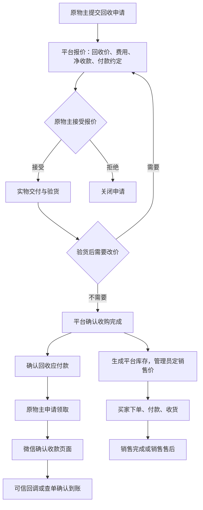
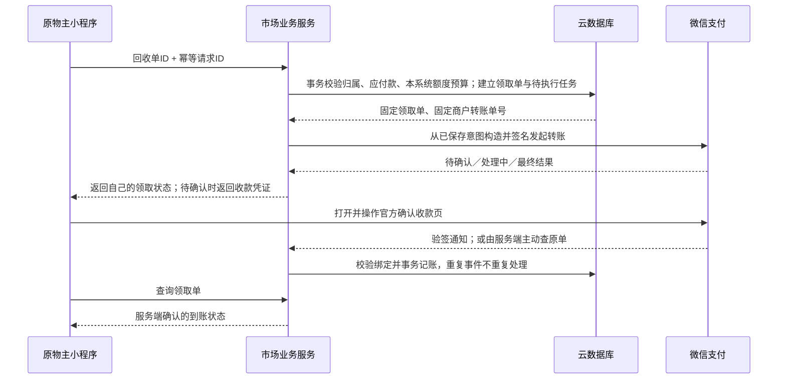

# 市场重设计：回收、销售与回收款领取

日期：2026-09-05。本文是后续实现的主设计，尚未部署或启用真实付款。沿用已选定的“平台实际回收后再销售、商家转账二手回收场景 1010”。

配套文件：[API 与接口安全填写表](../wechat-transfer-api-security-fill-sheet.md)、[非秘密配置核对模板](../wechat-transfer-readiness.template.json)。前一份[接入计划](2026-09-05-recovery-transfer-integration.md)保留已完成的参数修正和测试记录；后续模块划分、接口及页面以本文为准。

## 1. 确定的业务关系

平台接收实物、验收并确认收购后，承担向原物主付款的责任，并成为该商品的销售方。回收价和销售价分别确定。原物主领取回收款不以商品再次售出为前提；销售退款也不能自动扣回其已确认的回收款。

| 关系 | 业务记录 | 付款方向 | 所用能力 |
| --- | --- | --- | --- |
| 原物主将物品卖给平台 | 回收订单 | 平台 → 原物主 | 商家转账，场景 1010 |
| 买家购买平台库存 | 市场销售订单 | 买家 → 平台 | 小程序支付 |
| 买家退货退款 | 销售售后单 | 平台 → 原买家 | 对原支付单退款 |

本版不产生第三方商户分成，**分账不作为必开项**。将来增加合作分成，再为新的业务关系设计。回收款页面不是可充值、互转的通用钱包。

## 2. 用户与管理员看到的流程

### 原物主

1. 提交物品名称、分类、图片、成色、缺陷、交付方式；不由用户自行声明已完成回收。
2. 查看报价页：回收总价、服务费、净收款、报价有效期、验货改价处理、付款时间约定。确认时绑定报价版本。
3. 交付后查看验货结果；改价必须再次确认。未达成一致则记录退回交付，不能直接把商品转为平台库存。
4. 确认收购后，在“我的回收款”查看可领取款项，按回收单申请领取。
5. 打开微信官方收款确认页；返回后显示查单结果。未完成确认可回到原领取单继续，不能再次新建一笔付款。

### 买家

市场展示平台已收购的可售库存，明确标注“平台出售”、实拍成色、缺陷、售后及交付约定。买家创建独立销售订单，按服务端定价付款，完成交付或走销售售后；不会直接给原物主转账。

### 管理员

“回收工作台”处理报价、验货与入库；“市场订单”处理销售和售后；“回收款管理”核对应付款、领取中款项、失败原因和对账差异。权限由服务端配置。现有代售点 outlet_admin 不自动获得回收定价、市场退款或付款权限。

## 3. 页面与历史数据处理

| 页面 | 规划 |
| --- | --- |
| 市场首页 | 新增平台库存入口；历史个人信息发布另设清楚的入口和交易说明 |
| 商品详情 | 平台商品可下单；历史个人发布继续联系交易，不显示平台付款按钮 |
| 回收申请与详情 | 申请、报价版本、确认、验货、交付记录、回收款入口 |
| 我的回收款 | 待验收、可领取、领取中、已领取；按回收单查看明细 |
| 领取详情 | 净收款、手续费、处理中原因、继续确认收款、到账记录 |
| 我的订单 | 区分市场购物、回收订单与现有代售点订单 |
| 后台市场管理 | 回收、库存、销售、售后、财务对账及异常处理 |

历史 goods 中“已售”只是用户标记，不迁移成已付款订单或应付款。“求购”价格是预算，不转成销售库存。旧聊天消息不作为收购或付款凭证。原图、报价、交付证据在订单保存快照；删除或下架商品不能删掉订单和账务记录。

## 4. 状态与金额规则

回收业务状态和付款状态分开存储，不能用一个“已完成”覆盖两者。

| 对象 | 建议状态与主要约束 |
| --- | --- |
| 回收单 | 已申请 → 已报价 → 已接受 → 验货中 → 收购完成；改价回到待接受；关闭记录退回情况 |
| 平台库存 | 待上架 → 在售 → 订单锁定 → 已售；只有实际完成收购才能生成 |
| 销售单 | 待支付 → 已支付 → 交付中 → 已完成；关单、退款申请和退款结果另外记录 |
| 领取单 | 已预留 → 待渠道处理／待用户确认／处理中 → 渠道成功或渠道终态失败/撤销；未知结果持续占用 |

所有金额以整数“分”存储，服务端计算。每份接受的报价固化 gross_amount、fee_amount、net_amount、fee_rule_version，满足总价 = 费用 + 净收款；净收款不得为负。

费用比例、最低领取额和付款期限目前没有最终业务值，本文不代填。首版默认不开收费开关；若启用收费，必须先配置有效规则并在接受报价前展示。领取时按原报价结算，不临时加费；失败、取消和重试不重复收费。费用实际确认与成功付款同一次账务处理。已被渠道受理的付款，仅可信通知或查单确认终态 FAIL / CANCELLED 后释放该次预留。前端 cancel / fail 仅表示收款页面交互结果，不改变渠道状态、不释放预留；仍处于 WAIT_USER_CONFIRM 时复用原领取单和有效收款凭证。

首版采用**一份已验收回收单对应一次全额净款领取**，不做跨订单合并或任意部分领取，便于核对商品和付款依据。最低金额、单笔、单用户日累计、商户日/月累计必须使用正式获批额度。截图预览的 0.10–200 元、单用户每日 200 元、商户每日 5,000 元不能作为“已配置”的证据。官方另有个体户月累计规则，设置时一并核对。[官方额度说明](https://pay.wechatpay.cn/doc/v3/merchant/4013747667)

代码能力还有限制：当前未实现收款姓名加密，首版不接收 user_name，并要求每单净应付金额严格小于 200,000 分（2,000 元），同时服从更低的获批额度。报价、接受、收购确认和领取四处使用同一服务端校验，不能获批更高额度后直接放开。若需达到该金额，另行实现真实姓名获取、敏感字段加密、Wechatpay-Serial 配置与隐私保护后再调整。[发起转账的姓名要求](https://pay.wechatpay.cn/doc/v3/merchant/4012716434)

报价与接受前检查计划付款金额及能力，避免形成无法按约履行的承诺。不得自动拆单绕过渠道限制。收购后发生额度或资金不足，应显示未付应付款并处理履约安排，不能清零用户款项。

## 5. 资金处理与重复付款控制

- 收购完成以回收单唯一键确认一次应付款；创建领取单时原子预留净款、费用及按正式规则计算的本系统额度预算，同时创建 payment_jobs 待执行任务。本地事务不能锁定微信侧额度，渠道在调用时仍可能拒绝。
- 微信请求在数据库事务提交之后执行。事务回调可能重试，内部不能直接调用支付、退款或转账 API。
- 同一领取过程使用固定 out_bill_no。网络超时、进程退出或未知状态时，查询原单并保留预留；不换号、不重复付款。
- 只有渠道明确的终态失败或撤销，才按幂等规则释放对应预留；再次领取生成关联原失败尝试的新记录，保留完整轨迹。同一回收应付款累计成功金额不得超额。
- 对未被受理的请求，只有经验证的渠道明确拒绝、且核实该错误表示原单未创建时，才关闭本地意图并释放预留。网络超时、连接中断或单次查不到单都不等于未创建；不能以此另建付款。拒绝错误的分类按官方接口语义实施和验证。
- 成功终态不因晚到失败通知回退。出现互相矛盾的结果时，冻结该单自动重试并核查渠道，不直接按最后一条消息覆盖。
- 日/月额度使用 Asia/Shanghai 的时间边界和事务预留。跨日、跨月的未完成转账继续单独追踪，核对渠道实际计额度时点，不能简单清空计数。
- 本地额度记录只覆盖本系统；同商户后台手工转账或其他系统付款也会影响渠道额度，必须处理渠道拒绝并对账。
- 用户的钱款记录是平台的应付款；实际转账从商户运营账户出资。销售收款、结算到银行卡和运营账户充值分别核对，不把销售订单金额直接当成可用转账余额。
- 正式收购前核实运营账户、充值权限及负责人、初期应付款资金安排；上线前核验运营账户可用资金并配置低余额提示。后续按实际可用的渠道查询或后台核验流程更新，余额未知不能当充足，系统不自动发起充值。

官方收款交互采用 wx.requestMerchantTransfer；前端 success 不能证明到账。仅待用户确认时，向该单所属用户返回 package_info 并调起官方页面。其他状态按当前官方枚举映射，未识别状态进入待核查，不能当成功或失败。[小程序确认收款](https://pay.wechatpay.cn/doc/v3/merchant/4012716430)

## 6. 后端组织与业务接口

采用现有 Node.js HTTP 支付函数的模块化结构，新增回收、市场销售、领取账务三个服务模块。先复用云数据库和支付适配器，不另建三套支付服务。全部主动微信支付请求由同一个已核实固定出口的支付资源发出；定时补偿通过受信任的内部任务入口运行，入口不得接受外部指定金额或任意目标 URL。

建议新增位置：services/marketRecoveryService.js、services/marketSaleService.js、services/marketClaimService.js、services/paymentJobService.js 及 controllers/marketController.js。这些名称是待实现设计，目前不代表文件已存在。

小程序继续使用 wx.cloud.callHTTPFunction。下表都是**待新增接口**，统一 POST /wx-pay/加上接口名称。实现时同步 routes/pay.js 和 app.js 根入口动作白名单，以及小程序调用封装；不能仅写文档就直接调用。

| 接口名 | 客户端业务输入 | 服务端限制 / 返回 |
| --- | --- | --- |
| market_catalog_list / market_catalog_get | 分页筛选或库存ID | 只返回在售商品的公开字段，不暴露原物主及回收成本 |
| market_recovery_submit | 商品资料、幂等ID | 可信当前用户；返回回收单ID |
| market_recovery_list / market_recovery_get | 分页游标或回收单ID | 只返回本人记录；管理查询单独授权 |
| market_quote_accept | 回收单ID、报价版本、幂等ID | 校验报价有效、版本及归属 |
| market_recovery_cancel | 回收单ID、原因、幂等ID | 仅收购确认前；实物已交付时先进入退回流程，不能直接关闭 |
| market_claim_create | 回收单ID、幂等ID | 验收、应付额、归属与额度校验；返回领取单ID与状态 |
| market_claim_get | 领取单ID | 本人可读；待确认时才返回官方收款凭证 |
| market_sale_create | 库存ID、交付信息、幂等ID | 事务锁库存、快照价格；返回销售单ID |
| market_sale_pay | 销售单ID | 服务端金额与付款人；返回官方支付参数 |
| market_sale_list / market_sale_get | 分页游标或销售单ID | 本人订单及可信支付状态 |
| market_sale_cancel | 销售单ID、幂等ID | 未支付才进入关单流程；先协调渠道结果再释放库存 |
| market_sale_confirm | 销售单ID、幂等ID | 仅买家、仅允许的交付状态确认收货 |
| market_refund_request | 销售单ID、原因、幂等ID | 创建售后申请，不能由前端直接发起任意金额退款 |
| admin_market_quote / admin_market_inspect | 回收单ID、报价或验货结果、版本 | 服务端市场管理权限；记录操作者与证据 |
| admin_market_recovery_confirm | 回收单ID、接受的最终报价版本、幂等ID | 独立收购确认权限；交付验货完成后，在同一事务确认收购、应付款与唯一库存 |
| admin_market_recovery_return | 回收单ID、退回交付记录、版本 | 未收购实物退回必须留证，确认退回后才能关闭 |
| admin_market_stock | 库存ID、价格、上/下架动作、版本 | 服务端库存权限；锁定或已售时禁止违规变更 |
| admin_market_sale_fulfill | 销售单ID、发货或线下交付凭证、版本 | 已支付才允许交付；保存可供买家核对的记录 |
| admin_market_refund | 售后单ID、审核结果、幂等ID | 独立退款权限；服务端计算可退金额和固定退款号 |
| admin_market_return_receive | 售后单ID、实物验收结果、幂等ID | 确认实际退货与成色；退款成功且可再售时才转待上架，不因退款自动恢复在售 |
| admin_market_finance_list / admin_market_reconcile | 查询条件或异常单ID | 财务权限；核查原单，不提供任意收款人转账能力 |

返回结构沿用现有封装，但增加业务错误码和 trace_id。例如 QUOTE_CHANGED、NOT_ACCEPTED、CLAIM_PENDING、LIMIT_EXCEEDED、CHANNEL_PENDING。只展示用户能采取的动作，日志中的上游详细错误与敏感材料不得原样返回。

支付和退款通过新的市场订单适配器处理。回调以服务端保存的商户订单号映射业务类型，不信任客户端声明“市场/代售点”。原代售点 orders、store_products 及其钩子继续独立。

## 7. 数据结构与可复核账务

| 拟新增集合 | 核心内容及唯一约束 |
| --- | --- |
| market_recovery_orders | 原物主、商品/报价版本快照、交付验货、应付款确认；收购确认唯一 |
| market_inventory | 回收来源、平台销售价格、状态、锁定销售单；同一回收实物只生成一次库存 |
| market_sale_orders / market_refund_requests | 买家、库存和价格快照、交付、支付及售后绑定 |
| market_payment_intents | 市场支付和退款意图、固定商户单号、渠道单号、业务类型；商户单号唯一 |
| market_claims | 回收来源、原物主、金额/费用快照、领取尝试、out_bill_no、渠道单号和状态 |
| market_finance_entries | 不可覆写的应付款确认、预留、释放、付款成功、费用确认记录；每个业务事件唯一 |
| payment_jobs | 事务内生成的执行/查单任务、租约、重试次数、下次执行时间；同一任务幂等 |
| market_channel_limits | 商户/用户、日/月窗口、规则版本、已预留与已确认用量 |
| market_finance_config / market_audit_logs | 费用与获批额度版本、启用开关；管理员操作与差异处理记录 |

实际索引需在实施时核对 CloudBase 能力；业务唯一性使用确定性文档ID、事务条件和支持的索引共同保证，不能只依靠“先查询不存在再新增”。幂等键绑定用户、操作和请求内容，不允许同一键换金额或换订单。

资金集合禁止小程序直接读写，通过服务端按身份过滤返回。金额账务只追加更正记录，不能通过管理页直接修改历史成功流水。每日可复算：已确认净应付款 = 尚可领取 + 领取中预留 + 已成功支付，并核对各订单费用与渠道金额；回收、销售、退款和运营账户分开对账。

## 8. 接口安全设计及现状差距

| 安全边界 | 实施要求 | 目前代码情况 |
| --- | --- | --- |
| 小程序 → 业务服务 | 验证真实会话；服务端判定用户和角色；逐单校验归属 | 当前 JWT 解析不验签，部分头字段依赖上游网关保证；公网入口保证尚未核实 |
| 业务服务 → 微信 | 可信数据库意图；请求签名；固定出口 IP；验证微信响应签名 | 转账服务显式关闭；手写转账请求尚缺响应验签 |
| 微信 → 回调 | SDK 严格验签解密，或验证不可伪造的可信网关来源；与原意图绑定 | 当前 gateway 路径会接受 ParsedContent；不能直接暴露并信任任意明文 |
| 用户/管理员 → 领取 | 用户只能提交自己的回收单；金额、openid、1010报备取服务端 | 原始 transfer 控制器允许请求自带 openid，不能作为新领取入口 |
| 云部署 → 微信接口安全 | 实际执行转账资源的固定公网出口，与微信后台名单一致 | 本地未找到可核实的固定出口；部署清单与小程序函数名称不一致 |

这些是本地审查确认的接入差距，不代表已经验证过线上攻击或实际泄漏。实现顺序是补业务和身份边界，再接转账适配器；不能只去掉“未启用商家转账”的保护。

身份策略：云网关模式须确认它验证登录、清除用户伪造的身份头且后端不可绕过；若无法建立这种边界，业务接口自行验签受信任的登录令牌。不能把“能解码 JWT”“存在 x-wx-openid”或 CORS 当成认证。

通知策略：为新增转账通知优先实现明确的 SDK 验签解密入口；如沿用集成网关，先验证它支持转账事件和可认证来源。当前 signMode 是全局配置，不能为了转账直接切换并破坏已有支付/退款通知；需要单独通知策略或整体迁移验证。

处理通知前核对已保存的商户单号、渠道单号、金额、商户及收款归属。某种通知缺少绑定所需字段时，按官方查单补全，不能自己补一个“通过”值。只有核验并持久化业务结果后才返回成功应答。重复通知应返回同样成功，不重复记账。

私钥、APIv3 密钥和完整收款凭证不进入前端、Git 或公开日志。凭据由服务端受保护配置读取；配置校验失败时禁用相应金融操作。查询和重试入口也要鉴权、限频，并限制只能查本系统绑定的业务单。

## 9. 决策与取舍

| 决策 | 采用原因 | 代价 / 未采用方案 |
| --- | --- | --- |
| 回收与销售分开 | 符合平台实际收购关系，付款与售后可分别核对 | 平台承担收购资金占用、库存和销售售后责任；不沿用个人互卖款项代收逻辑 |
| 单一支付出口、内部模块拆分 | 复用现有技术栈，降低出口管理、凭据和部署复杂度 | 共用资源故障影响多个流程，需要任务补偿；暂不拆成多套微服务 |
| 首版按回收单全额领取 | 商品报备、幂等与账务易核对 | 暂无合并/部分领取；额度不足需履约处理 |
| 事务意图 + 异步补偿 | 处理渠道与数据库无法同事务提交的问题 | 允许短暂“处理中”，需维护任务、查单和告警 |

平台回收资金和云网络费用要分别预算。固定出口方案可能新增 EIP、NAT 或资源套餐费用；需以实际部署产品及控制台报价核算，本文没有购买任何云资源。

## 10. 实施顺序与验收

1. **确定部署资源和配置**：按填写表核实真实环境、HTTP 函数/云托管类型、入口认证、固定出口、正式场景及额度，核验运营账户出资安排。修正部署清单命名后再部署；金融开关保持关闭。
2. **回收闭环**：申请、报价接受、验货、入库与应付款确认；完成用户/管理权限及订单快照。明确费用和付款期限后才能承诺正式业务。
3. **账务与领取接口**：事务预留、固定付款单、任务恢复、限额管理、不可重复账本；先用模拟渠道验证，不触发资金。
4. **市场销售**：唯一库存、服务端定价、支付意图、交付、原路退款；回调分流不能影响已有代售点订单。
5. **转账与安全接入**：补身份、响应与通知验签；配置正式 IP 和凭据；接入官方确认收款及后台对账。
6. **发布验证**：隔离环境验证通过后，安排有真实回收依据和明确金额的真机验证，再启用对应功能。不得用付款接口做任意“测试赠款”。

必须覆盖的业务验证：跨用户访问与改收款人；重复报价接受/验收/领取；并发额度与库存；进程在渠道成功后、数据库记录前退出；回调重放/丢失/乱序；未知结果不换单；用户取消收款页；余额/IP/额度拒绝；跨日月；销售关单与付款竞争；退款失败不得先重新上架，退货成功后也须实际验收入库；销售退款不影响原物主回收应付款。未签名通知、伪造身份头和客户端金额必须被拒绝。

交付标准是订单、实物、账务和渠道结果能相互核对，并能恢复异常。仅填写 API 配置或开通产品不能替代上述业务实现。

## 11. 核对依据

- 本地：miniprogram/app.js、utils/payment.js、HTTP 支付函数 app.js、routes/pay.js、controllers/payController.js、services/payService.js、services/orderService.js、utils/cloudbaseAuth.js、config/config.js、cloudbaserc.json。
- [商家转账发起接口](https://pay.wechatpay.cn/doc/v3/merchant/4012716434)：服务端调用与通知参数。
- [二手回收场景参数](https://pay.wechatpay.cn/doc/v3/merchant/4013774592)：1010 与“回收商品名称”报备。
- [小程序确认收款](https://pay.wechatpay.cn/doc/v3/merchant/4012716430)、[商家转账安全配置](https://pay.wechatpay.cn/doc/v3/merchant/4013751010)。
